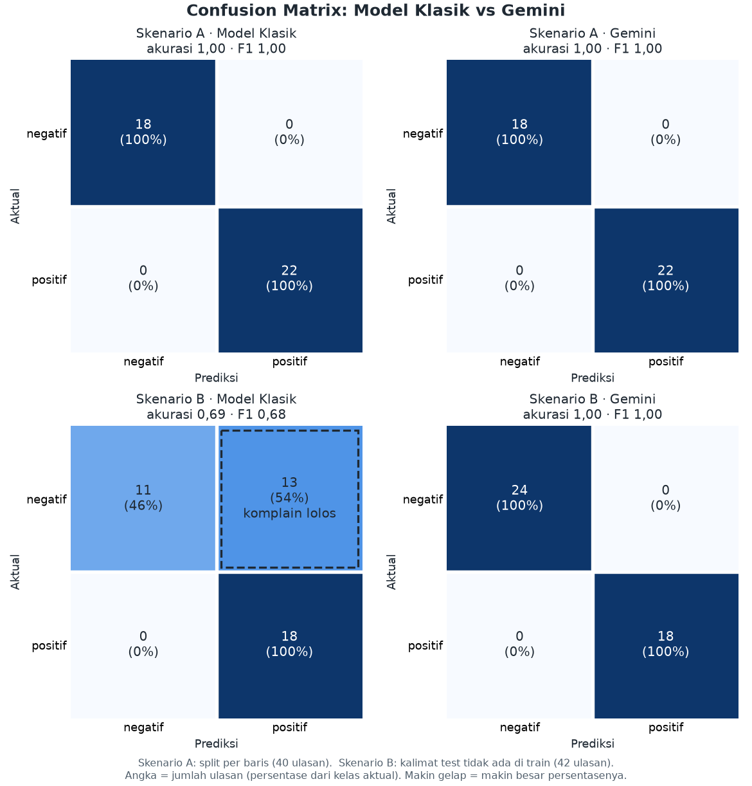

# Sentiment Analysis Ulasan Pelanggan: Model Klasik vs Gemini

Tugas individu AI Engineering Bootcamp (ReWork), Abdul Arif Wicaksono.

Ini catatan eksperimen saya membandingkan dua cara menebak apakah sebuah ulasan e-commerce itu positif atau negatif:
model TF-IDF + Logistic Regression yang saya latih sendiri dengan Scikit-learn, dan Gemini (`gemini-3.5-flash-lite`) yang cukup diberi prompt tanpa training.
Semua langkahnya ada di [`notebook/experiment_notebook.ipynb`](notebook/experiment_notebook.ipynb). README ini ringkasannya.

## 1. Masalah yang mau diselesaikan
Ceritanya, tim produk e-commerce ingin label sentimen muncul otomatis di setiap ulasan pada halaman produk.
Sebelum mereka memilih pendekatan untuk produksi, saya diminta mencoba dua kandidat dan memberi rekomendasi berdasarkan hasilnya.

Yang ditebak adalah kolom `sentiment`, isinya cuma dua:
- `positif`: pembeli puas.
- `negatif`: pembeli kecewa atau komplain. Ini termasuk keluhan soal pengiriman dan pelayanan, bukan cuma soal barangnya.

Asumsi yang saya pakai:
- Input-nya hanya `review_text`. Nama produk tidak dipakai.
- Tidak ada kelas netral.
- Label dari dataset saya anggap benar, dan file CSV-nya tidak saya ubah.
- Kedua pendekatan selalu dites di test set yang sama.
- Gemini dipakai apa adanya (tanpa fine-tuning) dengan kuota API gratis.

## 2. Dataset
[`data/customer_reviews_sentiment.csv`](data/customer_reviews_sentiment.csv), dataset yang dibagikan mentor.
Isinya 200 ulasan dari 15 produk, dengan kolom `review_id`, `product_name`, `review_text`, `sentiment`. Tidak ada missing value. Labelnya 110 positif dan 90 negatif.

Waktu eksplorasi saya baru sadar kalau 200 ulasan itu sebenarnya cuma 40 kalimat yang diulang-ulang dengan nama produk berbeda (ada yang muncul sampai 12 kali).
Ini ternyata berpengaruh besar ke cara saya membagi data (lihat bagian berikutnya).

## 3. Apa yang saya coba

**Pembagian data.** Awalnya saya split 80/20 per baris seperti di starter notebook (`stratify`, `random_state=42`), hasilnya 160 train dan 40 test.
Setelah dicek, 39 dari 40 kalimat di test set ternyata sudah ada di train set. Kalau begitu model klasik bisa dapat nilai bagus cuma karena hafal.
Karena itu saya tambah satu cara split lagi:
- **Skenario A:** split per baris seperti starter (160 train / 40 test).
- **Skenario B:** split per kalimat unik, yaitu 32 kalimat untuk train dan 8 kalimat untuk test (42 baris). Kalimat di test benar-benar belum pernah muncul di train.

**Model klasik.** `TfidfVectorizer()` + `LogisticRegression()` dengan setting default. Stopword sengaja tidak dihapus.
Daftar stopword bawaan sklearn untuk bahasa Inggris, dan kata seperti "tidak" justru penting buat sentimen.

**Gemini.** Prompt zero-shot (tanpa contoh). Saya tidak pakai few-shot karena kalimat di dataset ini berulang,
jadi contoh yang diambil dari train set bisa saja sama persis dengan soal di test set.
Prompt dari starter saya tambah konteks ulasan e-commerce Indonesia, definisi positif/negatif, pengingat soal kata negasi, dan permintaan menjawab satu kata saja.
`temperature` saya set 0 (di starter 0.2), karena untuk klasifikasi saya ingin ulasan yang sama selalu dapat jawaban yang sama.

Soal pilihan model, ini sempat bikin repot. `gemini-2.5-flash` sudah tidak tersedia (error 404), `gemini-3.8-flash` sering error 503 karena servernya penuh,
jadi akhirnya saya pakai `gemini-3.5-flash-lite`. Jawaban Gemini saya simpan ke CSV supaya notebook bisa dijalankan ulang tanpa memanggil API lagi.

**Uji tambahan.** Kalimat di dataset semuanya cukup jelas, jadi saya buat 10 ulasan sendiri yang lebih susah
(negasi, bahasa gaul, kalimat campuran, sindiran). Hasil ini hanya untuk melihat jenis kesalahannya, tidak masuk ke tabel metrik utama.

## 4. Hasil



| Pendekatan | Accuracy | Precision (macro) | Recall (macro) | F1 (macro) | Recall negatif |
|---|---|---|---|---|---|
| Model Klasik, Skenario A | 1.0000 | 1.0000 | 1.0000 | 1.0000 | 1.0000 |
| LLM API, Skenario A | 1.0000 | 1.0000 | 1.0000 | 1.0000 | 1.0000 |
| Model Klasik, Skenario B | 0.6905 | 0.7903 | 0.7292 | 0.6816 | 0.4583 |
| LLM API, Skenario B | 1.0000 | 1.0000 | 1.0000 | 1.0000 | 1.0000 |

Saya menambahkan kolom recall negatif karena menurut saya kesalahan paling merugikan untuk tim produk adalah komplain yang tidak terdeteksi.

Cara saya membaca tabel ini:
- Di skenario A dua-duanya sempurna. Untuk Gemini angka ini masuk akal karena dia tidak pernah melihat train set.
  Untuk model klasik saya tidak terlalu percaya, karena hampir semua kalimat test sudah dia lihat waktu training.
- Di skenario B model klasik turun ke accuracy 0,69, padahal train accuracy-nya tetap 1,00. Jadi jelas overfitting.
  Recall negatifnya cuma 0,46: 13 dari 24 komplain dianggap positif, dan semua kesalahannya ke arah yang sama (komplain dibaca sebagai pujian).
- Penyebabnya, model menilai kata per kata. Kata `respon` dan `ukuran` dia anggap positif karena di train hanya muncul di "respon cepat" dan "ukuran pas".
  Jadi "Respon penjual lambat..." ikut ditebak positif.
- Di 10 ulasan sulit, Gemini benar 10 dan model klasik benar 5. Model klasik salah di "kualitas tidak murahan" (kata `tidak` dianggap negatif),
  "jauh di atas ekspektasi", dan kalimat campuran seperti "Kurirnya ramah, tapi isi paketnya salah".

Dari sisi operasional:

| | Model Klasik | LLM API (Gemini) |
|---|---|---|
| Data latih & training | Perlu (160 ulasan, training kurang dari 0,1 detik) | Tidak perlu |
| Waktu prediksi per ulasan | Kurang dari 1 ms | Rata-rata ~2,5 detik (0,7–10,7 detik), sempat kena error 429 |
| Biaya per 1.000 ulasan | Gratis | Sekitar USD 0,05 |

Detail per kasus, termasuk tabel salah tebak, ada di notebook. Angka metriknya juga tersimpan di [`documentation/evaluation_summary.csv`](documentation/evaluation_summary.csv).

## 5. Trade-off dan keterbatasan
Kalau dilihat dari metrik, Gemini menang, apalagi untuk kalimat yang belum pernah dilihat. Tapi Gemini juga punya kelemahan sendiri.

Dari sisi effort, model klasik butuh data berlabel dan harus dilatih ulang kalau gaya bahasa ulasan berubah.
Dengan 40 kalimat unik, datanya jelas belum cukup. Gemini memang tidak perlu training, tapi tetap ada pekerjaannya:
menyusun prompt, merapikan jawabannya ke label yang valid, dan menangani error API (retry untuk 429/503).

Untuk kecepatan dan biaya, model klasik jauh lebih unggul. Prediksinya di bawah 1 ms, jalan di komputer sendiri, dan gratis.
Gemini butuh sekitar 2,5 detik per ulasan, tergantung internet dan kuota, dan biayanya naik seiring jumlah ulasan.

Keterbatasan yang saya lihat:
- **Model klasik** hanya menghafal kata, tidak memahami kalimat. Kata yang sebenarnya netral bisa ikut menentukan hasil,
  dan dia lemah di negasi, kalimat campuran, dan kata yang belum pernah muncul.
- **Gemini** lambat dan waktunya tidak stabil. Modelnya bisa dihentikan Google (seperti `gemini-2.5-flash` tadi), dan isi ulasan harus dikirim ke server luar.
  Di eksperimen ini Gemini belum pernah salah, tapi test set-nya kecil dan kalimatnya pendek-pendek,
  jadi saya belum berani bilang hasilnya akan tetap 100% di ulasan asli yang lebih panjang atau ambigu.

## 6. Rekomendasi
Saya merekomendasikan **Gemini untuk tahap awal**. Alasannya:
1. Di ulasan yang belum pernah dilihat, hasilnya jauh lebih baik (F1 1,00 vs 0,68 di skenario B, 10/10 vs 5/10 di uji tambahan).
2. Tidak ada komplain yang lolos (recall negatif 1,00 vs 0,46). Untuk fitur ini, menurut saya ini yang paling penting.
3. Data yang ada sekarang belum cukup untuk melatih model klasik yang layak, sedangkan Gemini tidak membutuhkannya.
4. Kelemahan utamanya, yaitu lambat, sebenarnya tidak terlalu masalah untuk kasus ini. Sentimen tidak harus muncul detik itu juga,
   jadi ulasan bisa diproses di background saat masuk lalu hasilnya disimpan. Biaya sekitar USD 0,05 per 1.000 ulasan juga masih kecil.

Kalau jadi dipakai, yang perlu disiapkan: retry untuk error 429/503, cache supaya ulasan yang sama tidak dikirim dua kali,
dan pengecekan berkala dengan sampel ulasan yang dilabeli manual.
Nanti kalau ulasan asli sudah banyak dan beragam, model klasik layak dicoba lagi. Kalau hasilnya sudah cukup bagus, bisa pindah ke situ supaya lebih hemat dan tidak tergantung API.

## 7. Isi repository
```
├── data/customer_reviews_sentiment.csv        # dataset asli (tidak diubah)
├── notebook/experiment_notebook.ipynb         # notebook eksperimen lengkap dengan output
├── documentation/
│   ├── model_comparison_summary.png           # confusion matrix kedua pendekatan
│   ├── evaluation_summary.csv                 # tabel metrik
│   ├── llm_predictions.csv                    # jawaban Gemini untuk test set A dan B
│   └── llm_predictions_uji_sulit.csv          # jawaban Gemini untuk 10 ulasan sulit
├── README.md
└── requirements.txt
```

## 8. Cara menjalankan
Saya pakai Python 3.12.

Windows (PowerShell):
```powershell
py -3.12 -m venv .venv
.venv\Scripts\activate
pip install -r requirements.txt
```

macOS / Linux:
```bash
python3.12 -m venv .venv
source .venv/bin/activate
pip install -r requirements.txt
```

Setelah itu buka `notebook/experiment_notebook.ipynb` di VS Code, pilih kernel `.venv`, lalu **Run All**.
Jawaban Gemini sudah ada di folder `documentation/`, jadi notebook bisa jalan sampai selesai tanpa API key.

Kalau ingin memanggil Gemini lagi:
1. Set environment variable `GEMINI_API_KEY`, atau buat file `.env` di root project berisi `GEMINI_API_KEY=api_key_anda`.
2. Hapus `documentation/llm_predictions*.csv`.
3. Jalankan ulang notebook.
